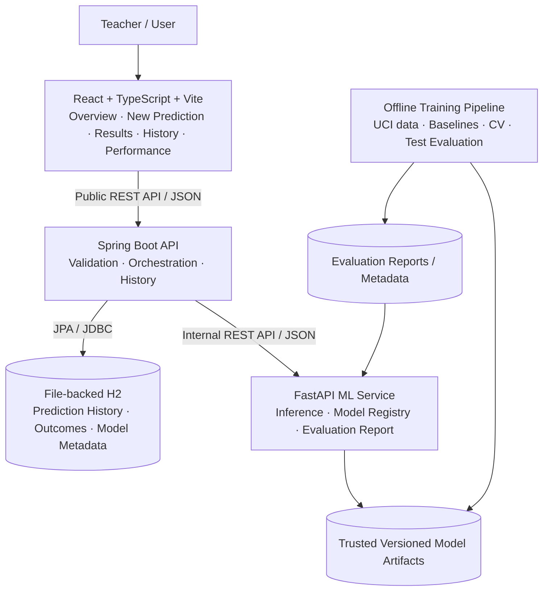

# CLASSROOM INSIGHT — FINAL MASTER PLAN

**Document:** `CLASSROOM_INSIGHT_FINAL_MASTER_PLAN.md`  
**Version:** 1.0  
**Plan date:** 17 October 2026  
**Status:** Sections 1–6 reflect the user's approved decisions. Section 7 defines the updated Antigravity-led, step-by-step implementation workflow.  
**Project type:** Academic ML web application / working prototype  
**Primary purpose:** Keep this document as the single source of truth for implementation, reviews, and scope decisions.

> **Source-of-truth rule:** Antigravity and ChatGPT must use this plan as the baseline. Do not silently change an approved requirement, technology, feature name, target, endpoint, design choice, or scope decision. If a conflict or missing decision is found, explain the issue and request a decision before making a consequential change.

---

## Project summary

**Classroom Insight** is a web application for teachers to estimate student final grades and pass/fail outcomes from a small set of student indicators. It must include a polished UI, reproducible machine-learning training and evaluation, live inference, model-performance reporting, and persistent prediction history.

The project is an **academic prototype**, not a validated student assessment system for deployment decisions. The initial public dataset describes students from Portuguese schools; model results do not establish validity for Indian schools. The pass/fail threshold `G3 >= 10` is a convention derived from this dataset and is not a validated standard for Indian education.

### Success definition

The goal is a tested, end-to-end application—not just UI mockups, unconnected services, or unverified model files. A teacher should be able to enter the eight inputs, request a grade or pass/fail prediction, view genuine results, save the prediction, reopen it from history, see evaluation metrics, and later record the actual final grade separately.

## Locked decisions at a glance

| Area | Decision |
|---|---|
| Dataset | Official UCI Student Performance — Mathematics file, `student-mat.csv` |
| ML tasks | Numeric final-grade regression and pass/fail classification |
| Regression target | `G3`, 0–20 scale |
| Classification target | Derived from `G3`: pass if `G3 >= 10`, otherwise fail |
| Input features | `G1`, `G2`, `studytime`, `failures`, `absences`, `schoolsup`, `famsup`, `paid` |
| Model families | Linear Regression, Logistic Regression, Decision Tree, Random Forest, SVM, KNN |
| Fitted model variants | Five regression variants and five classification variants, where training succeeds |
| Training policy | Reproducible offline training and evaluation; not triggered by live predictions or saved outcomes |
| New records | Save prediction inputs/results in the database; actual outcomes are recorded separately and may be considered for future retraining only after approval/evaluation |
| Frontend | React + TypeScript + Vite |
| Public backend | Java + Spring Boot |
| ML inference | Python + FastAPI + scikit-learn |
| Database | File-backed H2 for local MVP; Spring Boot owns application writes |
| Public request path | React → Spring Boot → FastAPI |
| Screens | Overview, New Prediction, Results, History, Model Performance |
| Navigation | Collapsible left sidebar on every screen |
| Theme | Purple / indigo / lavender palette specified in Section 1 |
| Charts | Essential charts first; advanced visualizations deferred |
| History | Included in the MVP and persisted across application restarts |
| Execution | Antigravity implements all phases, one phase at a time, using prompts supplied by ChatGPT and reporting results back for review |
| Estimate | 35–55 focused hours; planning estimate, not a guarantee |

---

# SECTION 1 — PRODUCT AND UI/UX

## 1.1 Product screens

The MVP has five screens. The left navigation is collapsible and remains available across screens. On narrow viewports, show a keyboard-accessible slide-out panel.

### Screen 1: Overview

**Purpose:** Starting point and at-a-glance status of the application.

Required elements:
- Welcome/header area describing Classroom Insight.
- Main call to action: **Create prediction**.
- Total saved predictions, sourced from the database.
- Number of currently available models, sourced from the model service/registry.
- Recent saved predictions linking to record details.
- Model-service health indicator using actual health checks.
- Loading, empty, degraded-service, and error states.

Do not hard-code fake counts, model availability, history entries, accuracy, or service status.

### Screen 2: New Prediction

**Purpose:** Collect the eight approved input features and submit a prediction request.

Required elements:
- Prediction goal: **Predict final grade** or **Predict pass/fail**.
- Model selection: one compatible model or compare compatible models for the selected task.
- Eight inputs: `G1`, `G2`, `studytime`, `failures`, `absences`, `schoolsup`, `famsup`, `paid`.
- Labels and short helper text for category encodings.
- Inline validation, submit-in-progress state, and service error handling.
- Optional non-identifying student reference; never require student names or dates of birth.

Because `G1` and `G2` are input features, this is a **late-stage estimate after two grading periods**, not a beginning-of-year early-warning prediction.

### Screen 3: Results

**Purpose:** Explain the result and compare models where requested.

Required elements:
- Prominent predicted grade or pass/fail class.
- Model name/version and prediction timestamp.
- Regression comparison bar chart using actual returned predictions.
- Classification result shown clearly as `Predicted Pass` or `Predicted Fail`.
- Per-model statuses when comparison has partial failures.
- Save/review history action and a new-prediction action.
- Clear disclaimer: predictions are estimates, not guarantees.

Do not show probability estimates unless those probabilities are properly calibrated and evaluated. No fake confidence score. Do not confuse per-student prediction values with model evaluation metrics.

### Screen 4: History

**Purpose:** Search, filter, and reopen persisted prediction records.

Required elements:
- Search by optional reference or model ID/name.
- Filters for prediction goal and date range.
- Pagination or “load more” for larger histories.
- Rows show prediction ID/reference, goal, model(s), status, and timestamp.
- Open a record to see full saved inputs and results without rerunning inference.
- Useful empty, loading, and error states.

History must use persistent database storage, not browser state alone.

### Screen 5: Model Performance

**Purpose:** Show how models performed on evaluation data.

Regression metrics:
- MAE (lower is better).
- RMSE (lower is better).
- R² (interpret with dataset/task context; higher is generally better).

Classification metrics:
- Accuracy.
- Precision, recall, and F1-score with averaging method documented.
- Confusion matrix, if available; it may be deferred as a visualization but classification evaluation still must be performed.

Show model/version, dataset, evaluation method, test-set sample count, and evaluation status. Metrics must be populated by actual training/evaluation output. Models that have not been trained/evaluated must not appear as available/evaluated.

## 1.2 Global navigation

Left sidebar entries:
1. Overview
2. New Prediction
3. History
4. Model Performance

Results are opened immediately after a prediction or via a saved history record; Results does not need its own permanent sidebar entry. A small profile/settings area may appear at the bottom later, but do not expand MVP navigation without need.

## 1.3 Final color palette

| Role | Hex | Usage |
|---|---|---|
| Sidebar | `#211B3B` | Deep purple navigation |
| Primary | `#6855F5` | Main actions and selected states |
| Hero | `#30265C` | Welcome/hero emphasis |
| Canvas | `#F7F6FC` | Main app background |
| Cards | `#FFFFFF` | Forms, tables, panels |
| Main text | `#292444` | Headings and main text |
| Secondary text | `#625C78` | Supporting copy |
| Success | `#087F70` | Positive state/status |
| Warning | `#92520A` | Caution/attention |
| Border | `#E7E3F0` | Card and input borders |

UI requirements:
- Use violet for primary actions, not every control.
- Text contrast must be checked against WCAG AA; do not rely on color alone to convey pass/fail, warnings, or errors.
- Prefer Inter or a similar clean sans-serif.
- Use a desktop-first responsive layout with accessible keyboard navigation, visible focus, proper labels, and chart descriptions.
- Every screen needs meaningful loading, empty, error, and service-unavailable states.

## 1.4 Visualizations

Essential MVP visualizations:
- Regression results: predicted grades comparison chart.
- Classification results: clear class result and comparison status; no fake probabilities.
- Model Performance: metrics table and simple chart(s) driven by actual evaluation data.

Defer advanced chart interactions, exports, decorative animation, and optional confusion-matrix visualization if time is tight. Do not remove History to spend time on advanced charts.

## 1.5 Product limitations to disclose

- UCI data originates from Portuguese schools, so results are not validated for Indian schools.
- `G3 >= 10` as pass is this dataset's convention, not an established Indian-school policy.
- The dataset is small; measured results may vary and must be presented with the evaluation method and limitations.
- Predictions are estimates, not decisions about a student's future.

---

# SECTION 2 — MACHINE LEARNING PLAN

## 2.1 Dataset

Use the official UCI Machine Learning Repository Student Performance dataset, Mathematics file `student-mat.csv`.

Official source: https://archive.ics.uci.edu/dataset/320/student-performance

Use the Mathematics file for the first version. Do not merge the Portuguese-language file into the initial training data. Record the source URL, access date, dataset/version identity, license, and relevant provenance in the documentation. The repository lists a CC BY 4.0 license; preserve attribution in the project report/README.

## 2.2 Prediction tasks and targets

**Task A — Regression**
- Predict `G3` as a numeric grade on the 0–20 scale.
- Report MAE, RMSE, R².

**Task B — Binary classification**
- Derive `pass_status` from `G3`.
- `pass` if `G3 >= 10`; `fail` if `G3 < 10`.
- Report accuracy, precision, recall, F1-score, and confusion matrix where supported.
- Document class distribution and metric averaging choices.

Never use `G3` as one of the prediction input features.

## 2.3 Model families and fitted variants

| Family | Regression variant | Classification variant |
|---|---|---|
| Linear Regression | Linear Regression | None |
| Logistic Regression | None | Logistic Regression |
| Decision Tree | Decision Tree Regressor | Decision Tree Classifier |
| Random Forest | Random Forest Regressor | Random Forest Classifier |
| SVM | Support Vector Regression (SVR) | Support Vector Classifier (SVC) |
| KNN | KNN Regressor | KNN Classifier |

Target is ten fitted variants in total, if each trains successfully. Linear and Logistic Regression are not interchangeable. If a model fails to train, record the failure; do not fabricate an available model or result.

## 2.4 Initial eight input features

| Feature | Meaning | Initial contract |
|---|---|---|
| `G1` | First-period grade | Integer 0–20 |
| `G2` | Second-period grade | Integer 0–20 |
| `studytime` | Weekly study-time band | Category 1, 2, 3, 4 |
| `failures` | Past class failures | Exact allowed values/semantics must be inspected in actual CSV and dataset documentation before final schema lock |
| `absences` | Absence count | Non-negative integer; verify empirical CSV range before final schema lock |
| `schoolsup` | School educational support | `yes` / `no` |
| `famsup` | Family educational support | `yes` / `no` |
| `paid` | Paid extra classes | `yes` / `no` |

For `studytime`, UCI defines the categories as: 1 = less than 2 hours; 2 = 2–5 hours; 3 = 5–10 hours; 4 = more than 10 hours per week.

Do not guess the exact `failures` mapping or maximum observed absences. Inspect the selected CSV and documentation. The canonical schema must contain actual valid values, not placeholders, before downstream application code is finalized.

## 2.5 Data preparation and evaluation

- Inspect schema, types, target/class distribution, missing values, duplicates, out-of-range values, and `G3 = 0` records.
- Make and document a `G3 = 0` policy. Keep them initially unless investigation supports an alternative; perform a sensitivity analysis with/without these rows.
- Use a fixed train/test split, for example 80/20. Use a stratified split for classification when appropriate.
- Use cross-validation and tuning only within training data. Keep the test set untouched until final evaluation.
- Fit preprocessing only on training folds/training data; package preprocessing with each fitted model in an sklearn Pipeline where appropriate.
- Fix random seeds where supported and record library versions.
- Evaluate deployed output behavior consistently. Regressors may return values outside 0–20; define and document whether outputs are clipped. If clipping is used, measure metrics on the same deployed-output policy.
- Include baselines: `G3 = G2` for grade regression; majority-class baseline for pass/fail classification; also compare a `G2`-only model with the full-feature model.
- Run an ablation comparison with and without `schoolsup`, `famsup`, and `paid`, since these may act as socioeconomic proxies. Document findings and limitations.
- Report test set size, split strategy, CV strategy, metrics, model version, dataset provenance, and uncertainty/limitations.

## 2.6 Training and data lifecycle

Training is reproducible and offline. The online prediction path loads approved artifacts and runs inference; it does not fit models or change artifacts.

Three data concepts must remain separate:
1. **Prediction history:** input features, requested task, model/version, predicted output(s), status, timestamp.
2. **Verified/recorded outcomes:** actual `G3` when available, linked to a prediction if appropriate, along with source/status and recorded timestamp. Teacher-reported does not automatically mean independently verified.
3. **Training candidates:** approved labelled examples selected through a deliberate training process. A saved prediction without an actual grade is not a supervised training example.

A predicted grade must never be treated as the actual grade. Candidate model versions are trained and evaluated offline; promote a new version only after comparison against existing model(s) and agreed acceptance criteria. Do not implement automatic retraining in the MVP.

## 2.7 Artifacts and safety

- Store fitted preprocessing/model pipelines as versioned artifacts.
- Pin compatible Python/scikit-learn/library versions.
- Only load artifacts created by the trusted training workflow; joblib/pickle artifacts can execute code on loading.
- Store model metadata: ID, version, task, dataset/version, evaluation metrics, creation time, artifact location, availability status.
- Never expose uncalibrated class probabilities as user confidence.

---

# SECTION 3 — FEATURE SCHEMA AND DATA CONTRACT

## 3.1 Canonical source of truth

Create `docs/feature_schema.json`. It defines:
- Schema version.
- Dataset identity and target convention.
- Exact feature names, ordering, types, valid ranges, category values, and meanings.
- Target definitions for regression and classification.
- Input validation behavior and any documented out-of-domain policy.

React TypeScript types/forms, Spring Boot DTO validation, FastAPI/Pydantic validation, and training scripts must agree with this schema. They may implement validation in their native language, but they must not reinterpret the fields.

Before release, inspect `student-mat.csv` and replace all draft/unknown values—especially for `failures` and empirical `absences` range—with verified values. Do not let a string placeholder or guessed allowed-value array remain in the canonical JSON.

## 3.2 Training targets

- `G3` is the numeric regression target, with dataset grade scale 0–20.
- `pass_status` is derived from `G3`: pass when `G3 >= 10`, fail otherwise.
- `G3` is never included in the eight inference features.

## 3.3 Public logical prediction request

The request envelope explicitly supports one model or comparison mode. Final JSON/API details are defined in Section 4.

Example input features (synthetic illustration only):

```json
{
  "G1": 12,
  "G2": 14,
  "studytime": 3,
  "failures": 0,
  "absences": 4,
  "schoolsup": "no",
  "famsup": "yes",
  "paid": "no"
}
```

## 3.4 Input validation

- Reject missing required fields, wrong types, invalid category values, and values outside the finalized allowed domain.
- Never silently convert arbitrary values or accept `G3` as an input feature.
- Apply validation at Spring Boot's public API boundary and again in FastAPI.
- Return a readable validation error without stack traces, filesystem paths, secrets, or private service details.
- Optional `student_reference` must be non-identifying and constrained to a strict pattern/length, e.g. `^[A-Za-z0-9_-]{1,32}$`, subject to implementation tests.
- Avoid collecting student names, dates of birth, or unrelated personal details.
- Use schema versioning for future changes and include `schema_version` where specified in internal/persisted records.

## 3.5 Database concepts

Use a relational schema conceptually containing:

**`prediction_history`**
- UUID prediction ID.
- Optional non-identifying student reference.
- Eight input features (or safely structured input JSON plus validated schema version).
- Goal and mode.
- Model IDs/versions and per-model results/statuses.
- Timestamp, schema version, and overall request status.

**`verified_outcomes`**
- Outcome ID and linked prediction ID when available.
- Actual `G3` (integer 0–20).
- Derived `actual_pass_status`.
- Source/provenance, verification status, and timestamps.
- This table is separate from predicted values.

**`model_registry`**
- Model ID/version and task.
- Availability/training/evaluation status.
- Dataset/version and evaluation method.
- Genuine evaluation metrics and sample count.
- Artifact reference and timestamps.

The final physical database design may normalize comparison results into a child table; keep semantics and relationships intact.

---

# SECTION 4 — API CONTRACT

## 4.1 Service boundary

Browser/React → public Spring Boot API → internal FastAPI service. React must not call FastAPI directly. Spring Boot owns persistence and public IDs. FastAPI owns inference and model-report access; it does not write to H2. Offline training writes trusted artifacts/reports through the controlled training workflow.

## 4.2 Public endpoints (React calls Spring Boot)

| Method | Endpoint | Purpose |
|---|---|---|
| `GET` | `/api/health` | Health of app, DB, and ML service |
| `GET` | `/api/models?goal=regression` | List available compatible models |
| `GET` | `/api/models/performance?goal=regression` | Genuine evaluation reports |
| `POST` | `/api/predictions` | Create single prediction or comparison and persist outcome/status |
| `GET` | `/api/predictions` | Paginated/filterable history search |
| `GET` | `/api/predictions/{id}` | Fetch full saved record without rerunning inference |
| `POST` | `/api/predictions/{id}/outcome` | Record actual final grade separately |

Classification uses `goal=classification` on model-list and performance requests.

## 4.3 Prediction request envelopes

Single model:

```json
{
  "goal": "regression",
  "mode": "single",
  "model_id": "random_forest_regressor",
  "student_reference": "STU-001",
  "features": {
    "G1": 12,
    "G2": 14,
    "studytime": 3,
    "failures": 0,
    "absences": 4,
    "schoolsup": "no",
    "famsup": "yes",
    "paid": "no"
  }
}
```

Comparison mode uses `"mode": "compare"` and `"model_ids": ["linear_regression", "random_forest_regressor"]` instead of `model_id`. These are synthetic examples. All examples must be tested against actual DTO/schema definitions before being treated as implementation truth.

A prediction response should include:
- `prediction_id` (created by Spring Boot).
- `goal`, `mode`, overall status.
- The validated/saved inputs (with optional reference when included).
- `results` array with model ID/version, per-model status, task-appropriate output, and model-specific error details if needed.
- `created_at` timestamp and `schema_version`.

Regression results use `predicted_grade`. Classification results use `predicted_class` (`pass` or `fail`). Never mix the two result types in a single individual model result.

## 4.4 Comparison partial failures

If some models succeed and another fails, preserve the successful predictions and return model-level status for each requested model. Overall status may be `partial_success`. If all selected models fail, return an appropriate gateway/service error instead of pretending prediction succeeded. Persist the request and per-model statuses if the public create operation reached the persistence stage, consistent with documented transaction/error semantics.

## 4.5 Performance endpoint response

Regression metrics: `mae`, `rmse`, `r2`. Classification metrics: `accuracy`, `precision_macro`, `recall_macro`, `f1_macro` (or another explicitly documented averaging convention), plus confusion matrix where available. Include dataset, evaluation method, model/version, status, test sample count, and other metadata needed by the UI.

Do not display zero or example values as metrics. If not evaluated, mark the model `not_evaluated`; never create fake bars or scores. Performance chart data must be actual evaluation output and remain separate from individual prediction results.

## 4.6 History endpoints

History supports pagination (`page`, `size` with a sensible maximum), optional goal filter, search query, and date range. Example concept:
`GET /api/predictions?page=0&size=20&goal=regression&q=STU-001`

- `GET /api/predictions/{id}` returns the original saved request/results and recorded outcome metadata without rerunning the model.
- Unknown ID returns `404`.
- `POST /api/predictions/{id}/outcome` accepts an actual `G3` from 0–20 and provenance/source such as `teacher_reported`; backend derives pass/fail. Preserve source and verification status. Saving an outcome never triggers retraining.

## 4.7 Internal FastAPI endpoints

| Method | Endpoint | Purpose |
|---|---|---|
| `GET` | `/internal/health` | ML service health |
| `GET` | `/internal/models?goal=regression` | Loaded compatible models |
| `GET` | `/internal/models/performance?goal=regression` | Actual evaluation reports |
| `POST` | `/internal/predictions` | Validated single/compare inference |

Internal service URL is configurable. In Docker Compose, Spring Boot calls the FastAPI service by Compose service name, e.g. `http://ml-service:8000`, not `localhost`.

## 4.8 Standard error response

Use a consistent public error shape:

```json
{
  "error": {
    "code": "VALIDATION_ERROR",
    "message": "Some inputs are invalid.",
    "details": [
      {
        "field": "features.G1",
        "issue": "Value must be between 0 and 20."
      }
    ],
    "request_id": "req-example-001"
  },
  "timestamp": "2026-10-17T10:30:00Z"
}
```

This is illustrative. Use generated request IDs. Recommended statuses: 200 success/read/completed inference, 201 where a resource is created, 400 or 422 consistently for validation, 404 missing record/model, 409 conflicting state, 502 unusable ML upstream response, 503 unavailable service, 504 upstream timeout, 500 unexpected internal error. Choose and document a consistent 400/422 convention. Never return raw stack traces or internal paths.

## 4.9 Reliability rules

- Configure bounded ML call timeouts; begin with 5–10 seconds and adjust after testing.
- Do not claim a prediction was saved when the DB write failed.
- Preserve partial comparison results where applicable.
- Avoid unsafe retries that can create duplicate records. Add idempotency support if retry-safe creation is needed.
- History remains usable if the ML service is unavailable, provided the database is healthy.
- Restrict FastAPI to trusted callers/internal network; do not treat an obscure URL as security.
- Dev proxy may route frontend `/api` to Spring Boot to simplify local CORS handling.

---

# SECTION 5 — ARCHITECTURE AND TECHNOLOGY STACK

## 5.1 Stack

**Frontend:** React, TypeScript, Vite, React Router, Recharts, Tailwind CSS or standard CSS. Typed API client to Spring Boot.  
**Application backend:** Java with a supported LTS version, Spring Boot, Spring Web, Bean Validation, Spring Data JPA, Maven.  
**ML service:** Python, FastAPI, Pydantic, scikit-learn, pandas, NumPy, joblib.  
**Database:** file-backed H2 for local MVP; managed by Spring Boot.  
**Orchestration:** Docker Compose; service configuration through environment variables.  
**Tests:** use the standard test tools for each stack (e.g. pytest/FastAPI TestClient, Spring Boot test framework, and frontend unit/build checks); exact dependency versions must be pinned/recorded.

## 5.2 Responsibilities

- React: forms, input validation for UX, navigation, charts, history interface, loading/error states.
- Spring Boot: public API, authoritative request validation, history/outcome/model metadata persistence, orchestration to FastAPI, timeouts/error mapping.
- FastAPI: internal inference, model loading, feature validation, model discovery and report access.
- H2: application records only; Python does not write directly to this DB.
- Offline training: training, evaluation, versioned artifacts and model report generation.

## 5.3 Architecture diagram (Mermaid source)



## 5.4 Local ports and networking

| Service | Default port |
|---|---:|
| React/Vite | 5173 |
| Spring Boot | 8080 |
| FastAPI | 8000 |
| H2 | Embedded in Spring Boot |

These are local development defaults; make ports configurable where practical. Browser traffic goes to Spring Boot public API, while Spring Boot uses the internal ML service hostname in Compose. Keep database files and approved artifacts in persistent locations as appropriate.

## 5.5 Recommended repository structure

```text
classroom-insight/
├── client/
│   ├── src/components/
│   ├── src/pages/
│   ├── src/charts/
│   ├── src/services/
│   ├── src/types/
│   └── package.json
├── server/
│   ├── src/main/java/.../controller/
│   ├── src/main/java/.../service/
│   ├── src/main/java/.../repository/
│   ├── src/main/java/.../entity/
│   ├── src/main/java/.../dto/
│   ├── src/main/java/.../config/
│   └── pom.xml
├── ml-service/
│   ├── app/main.py
│   ├── app/schemas.py
│   ├── app/inference.py
│   ├── app/model_registry.py
│   ├── training/train_models.py
│   ├── artifacts/
│   ├── tests/
│   ├── requirements.txt
│   └── Dockerfile
├── docs/
│   ├── feature_schema.json
│   ├── API_CONTRACT.md
│   ├── ARCHITECTURE.md
│   ├── MODEL_EVALUATION.md
│   └── reports/
├── data/                 # local/downloaded data; do not commit raw data by default
│   └── h2/               # persistent local DB files; gitignored
├── docker-compose.yml
├── .env.example
├── .gitignore
└── README.md
```

If the repository already exists, inspect it and report a mapping before reorganizing. Do not destructively replace working files without explaining why.

## 5.6 Security, privacy, reproducibility

- Do not commit secrets, `.env` files with real values, DB files, raw student data, or unapproved artifacts.
- Use synthetic demonstration values and optional non-identifying student reference codes.
- Keep FastAPI internal; public client calls go through Spring Boot.
- Only load artifacts produced by the trusted training pipeline.
- Store app configuration in environment variables; provide `.env.example` without real secrets.
- Before public deployment with student data, implement authentication, authorization, secure transport, retention controls, and backups. Local demo success is not production readiness.

---

# SECTION 6 — EXECUTION ROADMAP

## 6.1 Operating method

Antigravity will implement all project phases. ChatGPT will supply one prompt at a time, review the exact report pasted back by the user, compare the evidence to this plan, resolve errors/design gaps, and provide the next prompt only when appropriate. The user should not have to write application code manually unless a real manual action is required outside Antigravity.

Use **one phase at a time**, with a review gate after each. Antigravity can implement a whole phase, but it must not skip its tests or continue across gates without being told to proceed.

## 6.2 Estimated effort

| Phase | Planning estimate |
|---|---:|
| 0 — Project setup/contracts/dataset inspection | 3–5 hours |
| 1 — Train/evaluate ML models | 6–10 hours |
| 2 — FastAPI ML service | 4–6 hours |
| 3 — Spring Boot and persistence | 6–9 hours |
| 4 — React UI | 8–12 hours |
| 5 — Integration/end-to-end tests | 5–8 hours |
| 6 — Polish/documentation/demo | 3–5 hours |
| **Total** | **35–55 focused hours** |

This is a planning estimate, not a promise. A reasonable calendar window may be 3–5 weeks depending on available time and debugging.

## 6.3 Phases and gates

### Phase 0 — Inspect, freeze contracts, and set up
- Inspect current repository before editing.
- Acquire/inspect official `student-mat.csv` and verify source provenance/license.
- Verify `failures` values, empirical observed ranges, `G3 = 0` distribution, target balance, and feature meanings.
- Finalize `docs/feature_schema.json`, `docs/API_CONTRACT.md`, `docs/ARCHITECTURE.md`.
- Add README starter, `.gitignore`, `.env.example`, tests scaffolding, and early Docker Compose skeleton if useful.
- Gate: no schema placeholders, contracts consistent, setup documented.

### Phase 1 — Dataset and ML pipeline
- Validate dataset.
- Implement training and evaluation for the ten variants where possible.
- Include baselines, CV confined to training data, untouched test set, grade clipping policy, zero-grade inspection/sensitivity, and proxy-feature ablation.
- Save trusted artifacts and actual evaluation report.
- Gate: reproducible training command, real metrics, baseline results, artifacts load, limitations documented.

### Phase 2 — FastAPI
- Implement health, model list, performance, prediction endpoints.
- Load artifacts rather than training at service startup.
- Validate goal, model compatibility and schema.
- Implement single/compare mode and partial/all-model failures.
- Add tests for success and failure paths.
- Gate: tests pass (or environment blocker reported) and API response matches contract.

### Phase 3 — Spring Boot and database
- Implement public endpoints and DTO validation.
- Add file-backed H2 and JPA repositories/entities.
- Implement prediction history, record retrieval, outcomes, model metadata.
- Call FastAPI through configurable URL with timeout and error mapping.
- Add tests including persistence across restart and no retraining.
- Gate: API matches contract and records persist.

### Phase 4 — React frontend
- Implement five screens, collapsible left sidebar, approved theme, responsive states.
- Use typed Spring Boot client, not direct FastAPI calls.
- Use real API data for results/history/metrics. Clearly mark temporary fixtures; no fake final metrics.
- Add validation, loading, error and unavailable states.
- Gate: frontend builds/tests and screen flows agree with API.

### Phase 5 — Integration and end-to-end tests
- Run Compose and configure service-to-service DNS correctly.
- Golden-path test across Python, Spring Boot, React, and DB.
- Verify same model version/input yields consistent result through each path, using defined precision tolerance.
- Test service outage, invalid input, partial failures, DB write failure, reopening history without rerunning inference, and outcome recording without retraining.
- Gate: end-to-end path works; failures are handled and explained.

### Phase 6 — Quality, docs, and demo
- Verify desktop/mobile layout, keyboard focus, labels, contrast and accessible chart descriptions.
- Remove unlabelled demo fixture data from final demonstration.
- Complete README setup/training/testing/troubleshooting instructions.
- Include dataset caveats, pass threshold, small-sample limitations, and model metrics.
- Gate: a clean setup can reproduce the demo; known issues are disclosed.

## 6.4 Must-have vs defer

Must-have:
- At least one working trained regression model and one working trained classification model end-to-end, with genuine metrics.
- The goal of ten task-appropriate variants; any variant not ready must be visibly unavailable rather than faked.
- Five UI screens and collapsible navigation.
- Single and comparison inference.
- Real evaluation metrics.
- Persistent history; records reopen without inference rerun.
- Verified actual outcomes stored separately.
- Tests, documentation, clear limitations.

Defer first if schedule tight:
1. Advanced chart interactions/export.
2. Confusion-matrix visualization (not the underlying classification evaluation itself).
3. Decorative animations and nonessential polish.
4. Extra filters/dashboard summaries.

Do not silently drop persistent History or invent model outputs to meet the schedule.

---

# SECTION 7 — ANTIGRAVITY-LED IMPLEMENTATION AND COLLABORATION WORKFLOW

## 7.1 Updated agreement

The user wants Antigravity to implement **all phases from this plan**, while ChatGPT supplies step-by-step prompts and reviews each agent report. The user acts as the messenger between Antigravity and ChatGPT, and only does manual work when it cannot reasonably be performed by the agent.

Workflow:
1. ChatGPT supplies exactly the next prompt to paste into Antigravity.
2. User pastes it into Antigravity.
3. Antigravity inspects/implements the scoped phase and returns a report with evidence.
4. User pastes the full report (and any errors/screenshots or diffs that matter) back into ChatGPT.
5. ChatGPT reviews progress against this master plan, identifies gaps, and supplies either a correction prompt or the next phase prompt.
6. Repeat until the definition of done is met.

Do not ask the user to paste all prompts at once. ChatGPT should reveal/send only the next actionable prompt at each point in the conversation, though all phase intent is recorded here for continuity.

## 7.2 Manual work must be visually obvious

Any action the user must do outside Antigravity must be marked using a red highlight in the response/report, such as:

`<span style="color:red"><strong>🔴 MANUAL ACTION REQUIRED</strong></span>`

Then explain it in plain language with numbered, beginner-friendly steps. State exactly where to click, what to download/upload/paste, what filename/path to use, and what evidence to send back. Do not label ordinary agent work as manual.

Potential manual tasks include starting Antigravity, pasting the prompt, forwarding its report, authorizing a download if Antigravity's environment lacks access, or placing a downloaded dataset in the agreed path if the agent cannot obtain it. Do not assume a manual task is required before checking the agent's capabilities.

**If manual work is needed, ChatGPT's response must include the red-highlighted warning plus simple steps. Antigravity must also list manual actions in its report using the same red-highlight convention.** If the user's Markdown viewer does not preserve inline HTML styling, use an unmistakable red emoji and uppercase label as fallback.

## 7.3 Required report format from Antigravity

At the end of every phase/task, ask Antigravity to report:

1. **Phase/task and status:** completed / partially completed / blocked.
2. **Estimated overall project completion percentage:** explain what numerator/denominator or work scope it used; distinguish phase completion from total progress.
3. **Requirements addressed:** map work to section and requirement IDs/names in this plan.
4. **Files created/changed:** list paths and why.
5. **Commands actually run:** exact build/test/train commands.
6. **Test results:** passed, failed, skipped, or not run; do not claim unrun tests passed.
7. **Measured ML evidence:** dataset counts, split details, real metrics, artifact versions where relevant; no placeholders portrayed as results.
8. **Manual actions required:** red highlighted, with simple steps for user.
9. **Blockers/risks/unresolved decisions:** clearly separate verified facts from assumptions.
10. **Recommended next step:** but do not proceed into a new phase until ChatGPT reviews and user instructs Antigravity to continue.
11. **Plan deviations:** list any deviations explicitly; no silent changes.

User should paste the report as text. For material evidence that cannot be represented in the report (build logs, screenshots, file diffs, test files), include the relevant excerpt or attachment. Do not share secrets, credentials, real student personal data, or private environment variables.

## 7.4 20% progress checkpoint — mandatory

When the Antigravity report first indicates that overall project completion is **20% or more**, ChatGPT must pause before issuing the next phase prompt and ask the user to provide/attach this exact file:

`CLASSROOM_INSIGHT_FINAL_MASTER_PLAN.md`

Purpose: re-open the final source of truth at the 20% milestone and compare the actual repository/report against the approved plan before further work. Do not skip this checkpoint because the plan was provided earlier in the conversation. After the user re-attaches it, verify it is readable, compare progress, note any drift, and then supply the next prompt. If the report's percentage is unsupported or ambiguous, ask the agent to justify/recalculate it before deciding whether the threshold has been reached.

## 7.5 Antigravity rules (non-negotiable)

- Read this master plan before starting; use the named section and phase as the requirements baseline.
- Inspect the current repository and files before editing.
- Work on only the assigned phase/task; do not build all services in one huge pass or continue across approval gates.
- Before coding, briefly state goal, files, approach, dependencies, risks, and acceptance tests.
- Do not silently change feature names, target definitions, endpoint names/payloads, database ownership, stack, palette, screens, or user-approved scope.
- Do not fabricate model scores, chart values, predictions, database records, health checks or test success.
- Do not train models as part of online prediction requests or when a saved prediction/outcome is created.
- Keep Python inference separate from the offline training pipeline.
- Do not use untrusted ML artifacts; pin compatible library versions.
- Add/run appropriate tests for each functional phase; disclose unrun tests and environment blockers.
- Do not expose FastAPI to browser code.
- Keep student data minimal and use synthetic demo records.
- Do not commit secrets, real `.env` values, database files, raw student data, or unapproved artifacts.
- When a contract is incomplete or contradicts another, stop and report the conflict; do not guess.
- If a user action is truly needed, mark it red and explain it step by step.
- Report actual commands, exit statuses, test results, and known limitations.

## 7.6 Master startup prompt (paste first)

```text
You are the implementation agent for Classroom Insight. Follow the attached/provided CLASSROOM_INSIGHT_FINAL_MASTER_PLAN.md as the single source of truth. Your job is to implement the complete project phase by phase, test it, and report evidence. Do not silently change approved requirements.

Stack: React + TypeScript + Vite; Java Spring Boot; Python FastAPI + scikit-learn; file-backed H2 controlled by Spring Boot; Docker Compose for local orchestration. Browser request path: React -> Spring Boot -> FastAPI. Spring Boot owns application data writes. Live inference must not trigger training.

Dataset: official UCI Student Performance Mathematics file, student-mat.csv. Tasks: regress G3 (0-20) and classify pass/fail derived from G3 >= 10. Initial features: G1, G2, studytime, failures, absences, schoolsup, famsup, paid. Verify exact category values and empirical source ranges from the actual CSV before finalizing docs/feature_schema.json; do not guess. The dataset is from Portuguese schools and is not validated for Indian schools.

UI: five screens—Overview, New Prediction, Results, History, Model Performance—with collapsible left sidebar and the specified purple/indigo/lavender palette. Essential charts only at first; real report metrics only. Persistent history is required. Predictions and actual outcomes must be stored separately. Actual outcomes may be considered for future offline retraining only after approval and evaluation; do not auto-retrain.

Follow all phases and acceptance gates in the plan. Start with Phase 0 only: inspect the current repository, dataset access, and contracts; verify schema values; prepare the canonical docs, setup files, and starter documentation. Do not build ML, backend, or UI product features yet. First report the scope, files to inspect/change, approach, and acceptance tests; then perform Phase 0.

At the end, report: status, estimated overall project completion %, requirements covered, files changed, exact commands run, actual test/build results, ML evidence when applicable, manual actions, blockers/risks, deviations from plan, and next step. Any manual action must be marked with this red-highlight HTML: <span style="color:red"><strong>🔴 MANUAL ACTION REQUIRED</strong></span> and explained in simple numbered steps. Never claim a test passed if it was not run. Stop at the phase gate and wait for review.
```

## 7.7 Prompt sequencing (ChatGPT sends one at a time)

Use these as the phase goal/reference, not as permission for the agent to run all phases in one session. The next prompt is sent only after reviewing the previous report.

### Prompt 0 — Phase 0: repository and contracts

```text
Execute Phase 0 only from CLASSROOM_INSIGHT_FINAL_MASTER_PLAN.md. Inspect the current repository before editing. Obtain or locate the official student-mat.csv; if network access is unavailable, stop and mark the required download action in red with exact steps. Inspect the real CSV and verify target distribution, feature names/types, `failures` category values/semantics, empirical ranges, and G3=0 records. Finalize docs/feature_schema.json without placeholders, then create/align docs/API_CONTRACT.md, docs/ARCHITECTURE.md, .gitignore, .env.example, and a starter README. Set up or map the project folders without overwriting working code unnecessarily. Add the early Compose skeleton if feasible, but do not implement product features or train models yet. Run available schema/document/build checks. Report exactly in the required report format and stop for review.
```

### Prompt 1 — Phase 1: ML training/evaluation

```text
Execute Phase 1 only, using the finalized schema and Section 2 of CLASSROOM_INSIGHT_FINAL_MASTER_PLAN.md. Build a reproducible offline training pipeline for the official Mathematics CSV. Inspect/handle G3=0 according to a documented policy and include sensitivity analysis; use a fixed held-out test set and cross-validation only within training data; add G3=G2 regression and majority-class classification baselines; compare G2-only with full features; run feature ablation for schoolsup/famsup/paid; define the grade clipping policy and evaluate deployed outputs consistently. Train task-appropriate model variants, save trusted pipelines/version info, and generate genuine metrics and docs/MODEL_EVALUATION.md. Pin dependencies. Do not implement FastAPI/backend/frontend. Do not fabricate a result if a model fails. Test artifact reload/inference and report results, then stop for review.
```

### Prompt 2 — Phase 2: FastAPI inference

```text
Execute Phase 2 only. Implement FastAPI from the finalized docs/feature_schema.json and docs/API_CONTRACT.md. Add /internal/health, model listing, model-performance report, and prediction endpoints. Load trusted saved pipelines without retraining at startup. Validate feature schema and goal/model compatibility. Support single and compare modes with per-model partial failures and consistent error/status responses. Add tests for valid inference, invalid values, incompatible/unknown model, missing artifact, partial failure, and all-model failure. Run tests and report actual commands/results. Do not implement Spring Boot or React; stop at the gate.
```

### Prompt 3 — Phase 3: Spring Boot and persistence

```text
Execute Phase 3 only. Implement the public Spring Boot APIs in docs/API_CONTRACT.md using Bean Validation, Spring Data JPA, and file-backed H2. Spring Boot owns all application DB writes; FastAPI must not write to H2. Implement health, model list/performance, prediction creation, paginated history/list/detail, and actual-outcome recording. Connect FastAPI via configurable service URL with bounded timeout, request IDs and mapped upstream errors. Persist partial comparison results consistently. Store actual G3 separately and derive actual pass/fail; never trigger retraining. Add tests including validation, success, unavailable Python, partial failures, not-found history, persistence across restart, outcome validation, and DB failure where feasible. Run/report tests and stop.
```

### Prompt 4 — Phase 4: React UI

```text
Execute Phase 4 only. Implement all five approved screens in React + TypeScript using the collapsible left sidebar and palette from Section 1. Use a typed API client to Spring Boot only, not FastAPI. Follow feature/API contracts. Implement single and compare flows for regression/classification, results and model comparison, persistent history search/reopen, model performance reports/charts using genuine API values, and accessible loading/empty/error/degraded states. Any temporary fixtures must be clearly labelled and must not be mistaken for real metrics. Make the layout responsive and keyboard accessible. Run frontend build/tests, report actual results and stop.
```

### Prompt 5 — Phase 5: integration and end-to-end tests

```text
Execute Phase 5 only. Integrate frontend, Spring Boot, FastAPI, file-backed H2, model artifacts and Docker Compose. Use Compose service names for inter-container calls; do not use localhost between containers. Verify persistence locations. Implement/run the golden-path comparison between direct Python inference and the same request through Spring Boot/UI using the same model version and tolerance. Test validation errors, partial/all failures, Python unavailable, failed persistence, history reopening without new inference, and outcome creation without retraining. Confirm no unlabelled fixture/fake metric remains. Fix regressions, report exact commands/results and stop.
```

### Prompt 6 — Phase 6: finish, documentation, demo

```text
Execute Phase 6 only. Complete README setup/troubleshooting, environment examples, training/evaluation instructions, API documentation, limitations, and demo checklist. Verify accessible form labels, keyboard focus, contrast, responsive screens, chart labeling, and UCI/Portuguese-school/pass-threshold caveats. Check secrets/data/artifacts are not accidentally committed. Run all relevant builds/tests again. Demonstrate using synthetic, labelled input only. Report remaining issues honestly and stop for final review.
```

## 7.8 Definition of done

Classroom Insight may be considered ready for academic demonstration only when:

- [ ] All five screens and collapsible navigation work.
- [ ] Both regression and classification flows work end-to-end.
- [ ] Every model advertised as available has a trusted artifact and real evaluation evidence; not-ready variants are explicitly unavailable.
- [ ] Performance visualizations use genuine model-evaluation reports.
- [ ] Frontend, Java validation, Python validation, and training share the finalized schema.
- [ ] Single prediction and compare mode work; partial failures are shown clearly.
- [ ] Prediction history persists across restarts and opens without rerunning prediction.
- [ ] Actual outcomes are stored separately from predictions.
- [ ] No prediction/outcome save triggers automatic retraining.
- [ ] Golden-path and major error-path tests pass or the exact remaining failure is disclosed.
- [ ] README can be followed on a clean setup to reproduce the demo.
- [ ] No fake metrics, unlabelled fixtures, real student identifiers, secrets, or unapproved data are present.
- [ ] Dataset provenance, small-data limitations, feature-proxy caveats, and pass-threshold limitation are documented.

---

# CHATGPT ↔ USER ↔ ANTIGRAVITY OPERATING AGREEMENT

## How to work after this plan is saved

1. ChatGPT gives the **next single prompt**.
2. User copies it into Antigravity and runs the agent.
3. User pastes the complete Antigravity report back into ChatGPT. Include relevant error output or screenshots when requested.
4. ChatGPT compares the agent's claims/evidence to this plan; separates confirmed facts from guesses; identifies deviations, missing tests, and manual work.
5. ChatGPT provides a correction prompt or the next approved phase prompt. Antigravity does not self-authorize major scope changes.

### User's role

The user should not manually write code by default. The user starts the agent, pastes prompts/reports, confirms choices if a genuine decision is needed, and performs only outside-agent tasks explicitly flagged in red.

### ChatGPT's role

ChatGPT remains the plan reviewer, prompt writer, debugging partner, and change-control checkpoint. It must not assume the agent's claim is correct just because the report says “done”; ask for logs, tests, files, or exact evidence where needed.

### Antigravity's role

Antigravity implements code and project artifacts, runs commands where it has access, and reports evidence. It must be transparent about environment restrictions, tests not run, and incomplete work.

## Mandatory 20% check-in

At the first agent report indicating overall progress ≥20%, ChatGPT must pause and ask the user to attach/re-provide `CLASSROOM_INSIGHT_FINAL_MASTER_PLAN.md`. Compare the report/repository state against that file before sending the next implementation prompt. If progress calculation is unsupported, first ask Antigravity to justify its percentage and phase weighting.

---

# CHANGE CONTROL / DECISION LOG

| Version | Date | Change |
|---|---|---|
| 1.0 | 17 Oct 2026 | Consolidated approved Sections 1–6 and updated Section 7 to an Antigravity-led, phase-by-phase workflow. Added red-highlight manual-action rule, mandatory report structure, and 20% re-attachment checkpoint. |

Any future change must be recorded here with date, rationale, approved choice, and affected sections. Keep this file as the single source of truth; do not maintain competing unofficial copies without labelling their versions.
