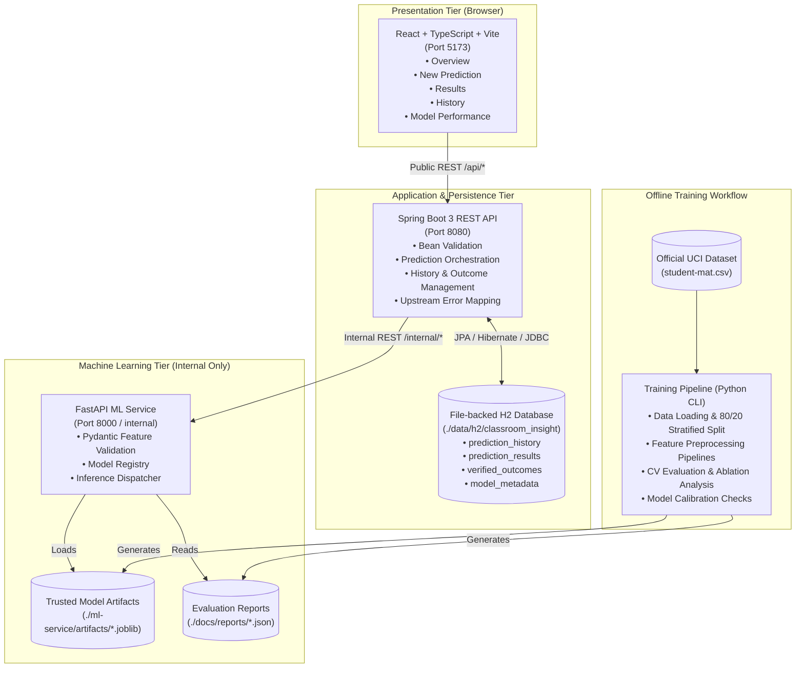
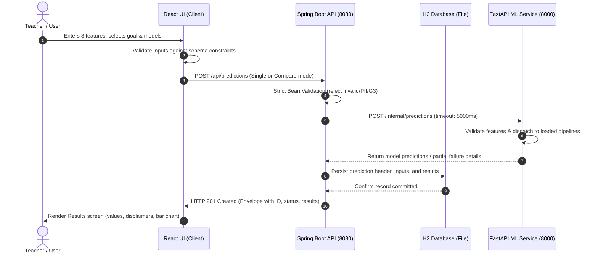
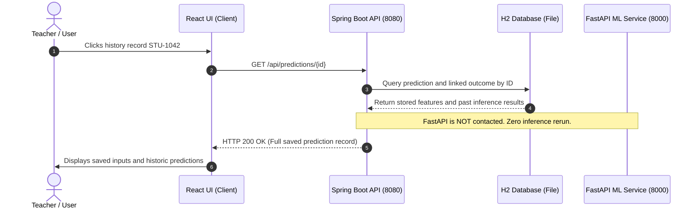
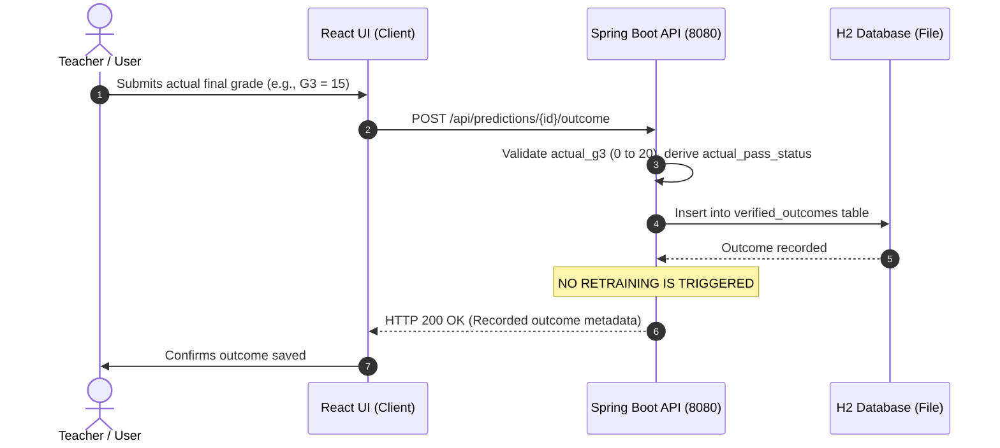
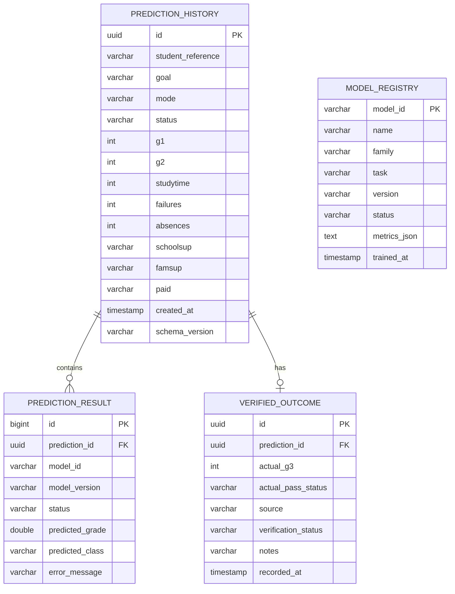

# Classroom Insight — System Architecture & Technical Design

**Document:** `docs/ARCHITECTURE.md`  
**Version:** 1.0.0  
**Status:** Approved & Canonical  
**Baseline Document:** `CLASSROOM_INSIGHT_FINAL_MASTER_PLAN.md`  
**Date:** 17 October 2026  

---

## 1. System Overview & Core Principles

**Classroom Insight** is an academic machine-learning web application designed for educators to estimate student academic trajectory—specifically final mathematics grade (`G3`, 0–20 scale) and binary pass/fail status (`G3 >= 10`)—from eight indicators captured after two grading periods (`G1` and `G2`).

### Core Architectural Axioms
1. **Separation of Concerns:** 
   - **Frontend (React)** handles interactive user experience, state management, and accessible visualizations.
   - **Public Backend (Spring Boot)** owns public API exposure, authoritative request validation, business rules, and relational persistence.
   - **Inference Service (FastAPI)** owns model serialization, scikit-learn pipeline execution, and model performance metadata retrieval.
   - **Offline Training Pipeline** is completely disconnected from live request flows.
2. **Authority & Ownership:** 
   - Spring Boot is the **only service** permitted to write to the application database (file-backed H2).
   - Python inference services and offline scripts never connect or write to the H2 database.
   - React never calls the FastAPI ML service directly.
3. **No Online Retraining:** 
   - Saving a prediction, querying history, or recording a verified student outcome **must never** trigger model training or alter serialized model pipelines.
4. **Authenticity of Data:** 
   - All evaluation metrics, model variants, predictions, and health statuses represent genuine computational outputs. No mock scores, unlabelled fixtures, or simulated confidence ratings are allowed.

---

## 2. High-Level Component Architecture

---

## 3. Technology Stack & Component Specifications

| Tier | Technology | Purpose & Responsibility |
|---|---|---|
| **Frontend** | React 18 / TypeScript / Vite | Single-page application, responsive layout, accessible navigation, form validation, data visualization (Recharts). |
| **Design System** | Vanilla CSS / CSS Variables | Approved purple/indigo/lavender palette (`#211B3B`, `#6855F5`, `#30265C`, `#F7F6FC`, `#FFFFFF`, `#292444`, `#625C78`). |
| **Public Backend** | Java 17/21 / Spring Boot 3 | Authoritative API gateway, Spring Web, Spring Data JPA, Bean Validation, RestClient/WebClient for upstream ML calls. |
| **Database** | File-backed H2 | Embedded, file-persistent local database (`data/h2/classroom_insight.mv.db`), surviving server restarts. |
| **Inference Service** | Python 3.10+ / FastAPI / Pydantic | High-performance inference engine, scikit-learn model loading, memory-resident pipeline execution. |
| **ML Engine** | scikit-learn, NumPy, pandas, joblib | Six algorithm families (Linear/Logistic Regression, Decision Trees, Random Forests, SVM/SVR/SVC, KNN), pipelines with scaling/one-hot encoding. |
| **Orchestration** | Docker Compose | Local containerized orchestration, internal DNS networking (`http://ml-service:8000`). |

---

## 4. End-to-End Execution Flows

### 4.1 Prediction Request & Persistence Flow

### 4.2 Reopening History Record (Zero-Inference Flow)

### 4.3 Recording Actual Verified Outcome Flow

---

## 5. Relational Database Architecture (H2)

Spring Boot manages the H2 schema through JPA / Hibernate with persistent file storage at `./data/h2/classroom_insight`.

---

## 6. Networking, Ports & Environment Configuration

| Service Name | Port | Local Dev URL | Docker Compose DNS URL |
|---|---|---|---|
| Frontend (React) | `5173` | `http://localhost:5173` | N/A (Client Browser) |
| Backend (Spring Boot) | `8080` | `http://localhost:8080` | `http://backend:8080` |
| ML Service (FastAPI) | `8000` | `http://localhost:8000` | `http://ml-service:8000` |
| H2 Database Console | `8080` | `http://localhost:8080/h2-console` | Embedded |

### Environment Variables
- `ML_SERVICE_URL`: Base URL for internal ML inference service (default: `http://localhost:8000`, in Docker: `http://ml-service:8000`).
- `SPRING_DATASOURCE_URL`: JDBC URL for file-backed H2 (`jdbc:h2:file:./data/h2/classroom_insight;DB_CLOSE_DELAY=-1;DB_CLOSE_ON_EXIT=FALSE`).
- `VITE_API_BASE_URL`: Base URL for Spring Boot public API (default: `http://localhost:8080/api`).

---

## 7. Machine Learning Lifecycle & Boundary Rules

1. **Dataset Integrity:**
   - Raw dataset: UCI Machine Learning Repository Mathematics course (`student-mat.csv`, 395 samples).
   - Provenance: P. Cortez & A. Silva (2008), CC BY 4.0 license.
   - Initial features: `G1`, `G2`, `studytime`, `failures`, `absences`, `schoolsup`, `famsup`, `paid`.
   - Feature domain invariants: `failures` allowed domain is strictly `[0, 1, 2, 3]` matching empirical data (`4` is absent from data and rejected); `absences` allowed domain is `0` to `93` (source definition) with observed range `0` to `75` in `student-mat.csv`.
   - Disallowed: `G3` is the target; it is never included in the input feature matrix.
2. **Algorithm Families & Variants:**
   - Linear Regression (Regression only)
   - Logistic Regression (Classification only)
   - Decision Trees (Regressor & Classifier)
   - Random Forests (Regressor & Classifier)
   - Support Vector Machines (SVR & SVC)
   - K-Nearest Neighbors (KNN Regressor & KNN Classifier)
3. **Evaluation Protocol:**
   - Fixed 80/20 train/test split.
   - Preprocessing (scaling, one-hot encoding) fit exclusively on training folds/sets.
   - Cross-validation (5-fold) executed solely on the training partition.
   - Regression baseline: $G3 = G2$ and mean predictor.
   - Classification baseline: Majority-class predictor.
   - Ablation analysis: Comparison with and without socioeconomic proxy features (`schoolsup`, `famsup`, `paid`).
   - Output clipping: Documented regressor clipping policy applied consistently across evaluation and live deployment.
4. **Safety & Execution:**
   - Model artifacts serialized via `joblib` into `./ml-service/artifacts/`.
   - FastAPI loads trusted artifacts only from this designated internal directory on startup.
   - No dynamic unverified pickle deserialization from external or network sources.
